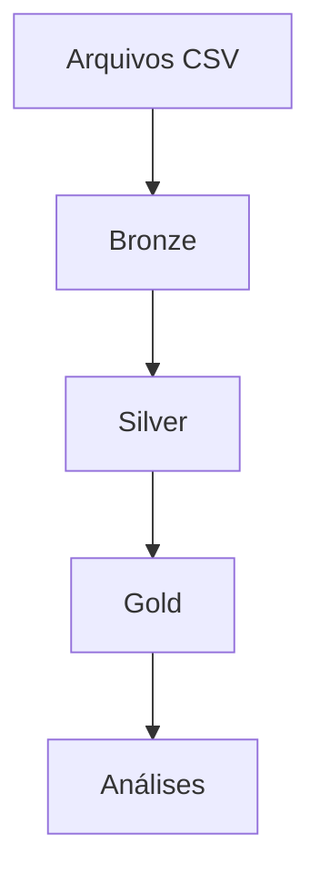

# CommerceFlow

> Pipeline de dados desenvolvido com Python e PySpark para transformar dados de e-commerce em conjuntos de dados preparados para análise.

## Tecnologias utilizadas

| Tecnologia | Utilização |
|---|---|
| Python | Desenvolvimento do pipeline |
| PySpark | Processamento e transformação de dados |
| Apache Spark | Engine de processamento de dados |
| Parquet | Armazenamento dos dados processados |
| Git | Controle de versão |

## Arquitetura

O pipeline utiliza uma organização em três camadas, conhecida como arquitetura Medallion.



Cada camada representa uma etapa do processamento:

- **Bronze:** recebe e armazena os dados originais em um formato estruturado.
- **Silver:** realiza limpeza, padronização e ajustes nos dados.
- **Gold:** organiza os dados em conjuntos preparados para análises.

## Dataset

O projeto utiliza dados públicos do [Brazilian E-Commerce Public Dataset by Olist](https://www.kaggle.com/datasets/olistbr/brazilian-ecommerce), disponibilizados no Kaggle.

Os dados representam operações de um marketplace brasileiro e permitem explorar diferentes aspectos de um negócio de e-commerce.

Os datasets utilizados até o momento incluem:

| Dataset | Descrição |
|---|---|
| Orders | Informações sobre pedidos e seus status. |
| Order Items | Produtos associados aos pedidos, preços e frete. |
| Customers | Informações dos clientes e localização. |
| Products | Informações sobre os produtos. |
| Sellers | Informações sobre os vendedores. |

## Estrutura do projeto

```text
commerce-flow/
├── data/
│   ├── raw/
│   ├── bronze/
│   ├── silver/
│   └── gold/
│
├── src/
│   ├── bronze/
│   │   └── ingest.py
│   │
│   ├── silver/
│   │   ├── orders.py
│   │   ├── order_items.py
│   │   ├── customers.py
│   │   ├── products.py
│   │   └── sellers.py
│   │
│   └── gold/
│       ├── inspect_orders.py
│       ├── orders_performance.py
│       ├── validate_orders_performance.py
│       ├── monthly_orders_performance.py
│       └── validate_monthly_orders_performance.py
│
├── .gitignore
└── README.md
```

Os arquivos armazenados em `data/` não são versionados no Git.

## Executando o projeto

### Pré-requisitos

- Python.
- Java (necessário para execução do Spark).
- Git.

### 1. Clone o repositório

```bash
git clone https://github.com/vinicius-lima-barbosa/commerce-flow.git

cd commerce-flow
```

### 2. Crie um ambiente virtual

```bash
python -m venv .venv
```

Ative o ambiente:

**Linux/macOS:**

```bash
source .venv/bin/activate
```

### 3. Instale as dependências

```bash
pip install pyspark
```

### 4. Prepare os dados

Baixe os arquivos do [dataset da Olist no Kaggle](https://www.kaggle.com/datasets/olistbr/brazilian-ecommerce) e coloque os CSVs utilizados na pasta:

```text
data/raw/
```

### 5. Execute o pipeline

**Bronze:**

```bash
python src/bronze/ingest.py
```

**Silver:**

```bash
python src/silver/orders.py
python src/silver/order_items.py
python src/silver/customers.py
python src/silver/products.py
python src/silver/sellers.py
```

**Gold:**

```bash
python src/gold/orders_performance.py
python src/gold/monthly_orders_performance.py
```

As etapas dependem dos dados gerados pelas camadas anteriores. Portanto, devem ser executadas na ordem apresentada.

## Próximos passos

- Desenvolver análises de desempenho de produtos.
- Criar conjuntos de dados analíticos para vendedores.
- Ampliar as validações de qualidade dos dados.
- Explorar consultas SQL sobre os dados processados.
- Documentar e aprimorar o pipeline.

---

Projeto desenvolvido para fins de estudo e portfólio em Engenharia de Dados.